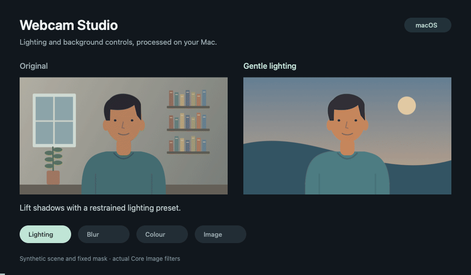

# Webcam Studio

A native macOS webcam recorder with lighting controls and background effects. Built with SwiftUI, AVFoundation, Core Image, Metal and Vision. Processing stays on the Mac.

Requires an Apple silicon Mac running macOS 15 or later and Xcode to build.



The animation uses a drawn scene and a fixed person mask with the app's Core Image filters. It illustrates the controls; live segmentation quality depends on the camera image. See [measured results and limitations](docs/VERIFICATION.md).

## Build

```sh
./build.sh
open "build/Webcam Studio.app"
```

The script uses an installed Apple Development signing identity when available. Set `SIGN_IDENTITY=-` to use local ad-hoc signing. Keep the same signing identity between builds to preserve camera and microphone permissions.

You can also open `Webcam Studio.xcodeproj` in Xcode and run the Webcam Studio scheme. The project defaults to ad-hoc signing; choose your development team if needed. The app is not sandboxed or notarised for distribution.

## Controls

Choose a camera and microphone independently. The quality menu offers supported 720p and 1080p capture modes. Actual resolution and measured frame rate appear below the preview.

**Background** offers:

- **Off:** keep the room visible.
- **Blur:** adjustable background blur while keeping the main presenter sharp.
- **Solid colour:** replace the room with a colour.
- **Photo:** choose a local image. It fills the frame while preserving its proportions. A copy is stored in the app's Application Support folder so moving the original does not break it.

Background effects use local person segmentation. Hair, fast-moving hands and held objects can have imperfect edges. Switch the effect off when demonstrating an object to the camera. While the person mask starts or is unavailable, the selected effect covers the full frame.

Lighting controls include exposure, shadows, highlight protection, warmth, contrast, saturation, noise reduction and sharpening. **Gentle** restores the starting preset. **Reset to Neutral** clears lighting adjustments and Auto Lighting. The **Enhancement** switch bypasses lighting adjustments; background effects have their own Off setting.

**Auto Lighting** adds bounded, smoothed exposure and shadow adjustments to the manual controls. It meters a small central region and limits gain around bright highlights.

Use **Original**, **Enhanced**, or **Compare** to inspect the same incoming frame. Original and Compare can show the untreated room. Recordings always use the chosen enhancement and background settings. **Mirror preview** affects preview only; recorded text remains unmirrored.

## Recording

Press **Record** or **⌘R**, choose a new `.mp4` filename, and press **Stop** when finished. Wait for finalisation, then use **Open Recording** or **Reveal in Finder**. Existing files are never replaced.

Output is H.264 video with mono AAC microphone audio: approximately 4.5 Mbps at 720p or 8 Mbps at 1080p, with SDR Rec.709 colour. Preview and recording use the same processed pixel buffers. Audio and video retain capture timestamps, including gaps when frames are dropped.

Check that the microphone meter moves before an important take. Selecting **No microphone** explicitly records silent video. Camera and quality changes are disabled during recording. Normal quit waits for the file to finalise.

## Checks

```sh
./test.sh
./inspect.sh /path/to/recording.mp4
```

The checks cover lighting, person masks, background composition, neutral/bypass behaviour, overwrite protection and decoded MP4 output. The inspector fully decodes video and audio, checks timestamps and orientation, and reports silent audio and frame gaps.

For an unattended real-device test, close the app and run:

```sh
open "build/Webcam Studio.app" --args \
  --verify-recording "$PWD/build/check-$(date +%s).mp4" --duration 20 \
  --qa-720p --qa-mic-ugreen --qa-background blur --qa-repeat --qa-quit \
  --qa-log "$PWD/build/check.jsonl"
```

This activates the camera and microphone and saves a local recording. `--qa-repeat` records a second six-second take. Use `--qa-1080p` to test 1080p. Omit `--qa-background blur` to use saved settings. Recorded clips and build output are excluded from Git.

Measured results and limits are in [docs/VERIFICATION.md](docs/VERIFICATION.md).

## Troubleshooting

Enable access under **System Settings → Privacy & Security → Camera / Microphone**, then relaunch. The app does not reset privacy permissions.

For missing video, check the USB cable, close competing camera apps, and click **Reconnect**. For silent audio, check the selected microphone, input volume and hardware mute. A closed MacBook can supply silent built-in microphone samples; a USB microphone may be a better choice.

Try 720p if the camera or processing struggles. The info button exposes processing time and reported capture/pool drops. Background segmentation runs on a separate bounded queue so it cannot accumulate old frames or block microphone capture.

Filtering cannot recover detail the camera did not capture. Low light, USB stalls and person-mask errors can still affect the result. Force-quitting or losing power may leave an incomplete hidden `.partial.mp4` file. This app records camera clips; it does not provide a system-wide virtual camera or slide composition.

## References

[Core Image filters](https://developer.apple.com/library/archive/documentation/GraphicsImaging/Reference/CoreImageFilterReference/index.html), [person segmentation](https://developer.apple.com/documentation/vision/vngeneratepersonsegmentationrequest), [capture-session timestamps](https://developer.apple.com/documentation/avfoundation/avassetwriter/startsession(atsourcetime:)), and [video colour metadata](https://developer.apple.com/documentation/avfoundation/tagging-media-with-video-color-information).

## Licence

[MIT](LICENSE), copyright 2026 Tamim Atiqur.
